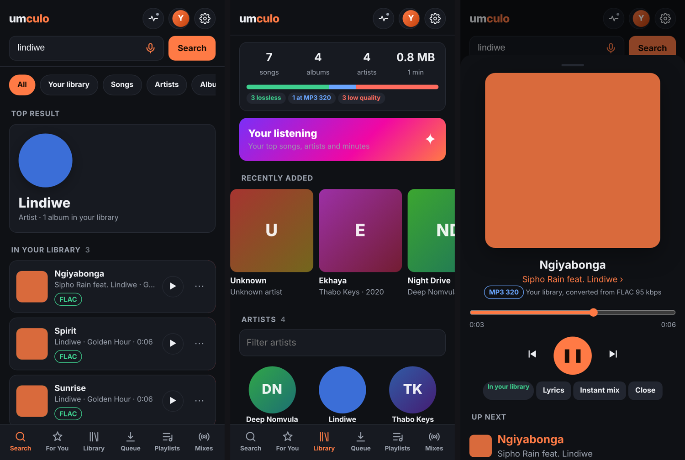

# Umculo

**Your whole music collection in one place, served from your own computer.**

*Umculo* (isiZulu for "music") is a self-hosted music server and web player. It plays and organises the music you own, works with the Subsonic apps you already use on your phone, and brings in the music you've bought or have the right to download from the sources you choose, in the quality you want.



> **Only download music you own or have the right to.** Umculo is a tool to bring *your* collection together into one all-in-one place. It doesn't come with any music, and it isn't for getting music you haven't paid for. You're responsible for what you download and how you use any source you connect.

## What it does

- **A music server for your apps.** Built-in Subsonic / OpenSubsonic API, so Subsonic apps like Arpeggi and Amperfy work with it. (A Jellyfin-style API is there too, still experimental.)
- **A web player** that works on phones and computers: search, library, queue, lyrics, instant mixes, a yearly "your listening" recap, light and dark mode.
- **Quality you can see.** Every song shows its format (FLAC, MP3 320…), and a quality profile decides what's good enough. Umculo can replace low-quality copies with better ones.
- **Playlists that stay in sync.** Paste a Spotify or Apple Music playlist link and Umculo builds it from your library and your sources, then keeps it up to date.
- **For You.** Weekly mix, "because you play…", rediscover old favourites, follow artists and get their new releases.
- **DJ mixes and podcasts.** Subscribe to shows, and Umculo can recognise the songs in a mix.
- **Tidy-up tools.** One folder per artist, duplicates removed, cover art and lyrics added.
- **Family accounts.** Everyone gets their own library, playlists and history. You choose what each person can do, and they can ask you for songs.
- **Safe to put online.** 2-step sign-in, app passwords for music apps, "only devices I approve", sign-in lockout, security headers. See [SECURITY.md](SECURITY.md).
- **Moving in is easy.** Bring stars, plays and playlists over from Navidrome, Plex or Jellyfin; your music files stay where they are.
- **Nightly backups** and **phone notifications** through ntfy.

## Quick start

You need Docker. Then:

```bash
mkdir umculo && cd umculo
curl -O https://raw.githubusercontent.com/mdu1223/umculo/main/docker-compose.yml
# edit docker-compose.yml: point /path/to/your/media at the folder that holds your Music folder
docker compose up -d
```

Open `http://<your-computer>:8095`, create your admin account, and Umculo scans your music. In your phone app, add a Subsonic server with the same address, your username, and an app password (Your account → Devices).

To update: `docker compose pull && docker compose up -d`.

### Building it yourself

```bash
git clone https://github.com/mdu1223/umculo.git && cd umculo
docker build -t umculo .
```

## Download sources (optional)

Umculo plays and organises your own music with no extra setup. To bring in music you have the right to, connect any of these in `docker-compose.yml`, then choose the order under **Settings → Where to look**:

| Source | What you need |
|---|---|
| Soulseek | a running [slskd](https://github.com/slskd/slskd): `SLSKD_URL`, `SLSKD_KEY`, `SLSKD_DOWNLOADS` |
| Usenet | Prowlarr + SABnzbd: `PROWLARR_URL`, `PROWLARR_KEY`, `SABNZBD_URL`, `SABNZBD_KEY` |
| YouTube / SoundCloud | nothing; built in through yt-dlp |

## Settings

Most settings live in the app (**Settings**). These are set in `docker-compose.yml`:

| Variable | Default | What it's for |
|---|---|---|
| `PORT` | `8095` | Port inside the container |
| `MUSIC_DIR` | `/data/Music` | Your music |
| `LIBRARY_DIR` | `/data/Music/Umculo` | Where new music goes |
| `PLAYLISTS_DIR` | `/data/Music/_playlists` | Playlist files (`.m3u8`) |
| `FAMILY_DIR` | `/data/Family` | Family members' own folders |
| `MIXES_DIR` | `/data/Music/meta_podcasts` | DJ mixes and podcast episodes |
| `CONFIG_DIR` | `/config` | Accounts, settings, database |
| `BACKUP_DIR` | `/backup` | Nightly backups (`BACKUP_HOUR`, `BACKUP_KEEP`) |
| `PUBLIC_URL` | | Your public address, for artist pictures in apps |
| `QUALITY_PROFILE` | `best` | `best`, `320`, `256` or `128` |
| `STREAM_QUALITY` | `320` | Quality when streaming songs you don't have yet |
| `INTERNET_KBPS` | `320` | Highest bitrate sent to devices outside your home (`0` = no limit) |
| `SOURCES` | `soulseek,usenet,soundcloud,youtube` | Where to look when you search |
| `BATCH_SOURCES` | same | Where to look for playlists and upgrades |
| `NTFY_URL` | | Phone notifications |
| `LISTENBRAINZ_USER` | | Better recommendations from your ListenBrainz history |
| `HOST_PATHS` | `/mnt/Storage/Media=/data` | Host-to-container folder mapping, for reading old playlists that use host paths |
| `SUPPORT_GITHUB`, `SUPPORT_KOFI` | project links | Donation links in Settings (blank to hide) |

## Putting it on the internet

Use a VPN (Tailscale/WireGuard) or a tunnel (for example Cloudflare Tunnel). Never forward port 8095 on your router. Then switch on 2-step sign-in, app passwords and "only devices you approve". Details in [SECURITY.md](SECURITY.md).

## Running the tests

The tests use made-up sample music and pretend versions of every outside service:

```bash
pip install mutagen segno shazamio py-opensonic && sudo apt install ffmpeg
bash test/run_api_tests.sh
```

## Support Umculo

Umculo is free and made in South Africa. If it's become your music app, you can support it on [Ko-fi](https://ko-fi.com/mdz10111). Thank you!

## Licence

[GPL-3.0](LICENSE). You can use, change and share Umculo freely; if you share a changed version, share its code under the same licence.
